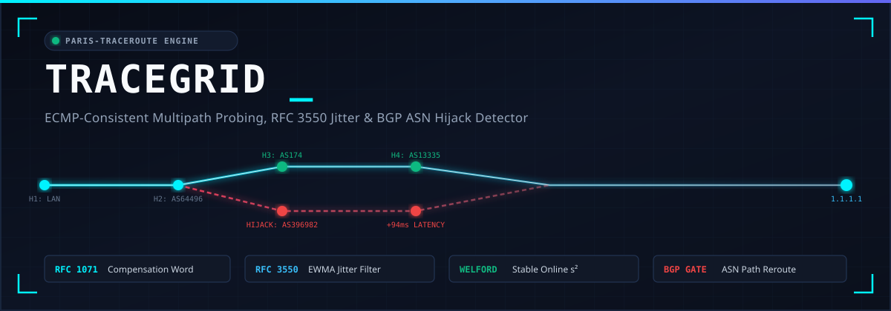
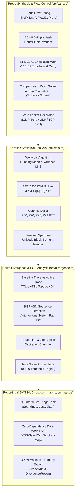
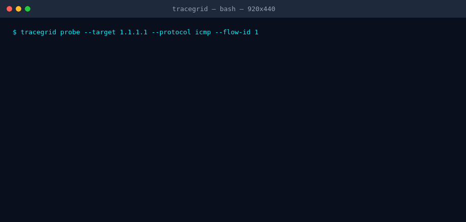

# Tracegrid — High-Performance Paris-Traceroute Flow Engine, RFC 3550 Jitter Telemetry & BGP ASN Path Divergence Analyzer

High-performance Equal-Cost Multi-Path (ECMP) consistent traceroute diagnostic engine, RFC 1071 / RFC 1624 16-bit Internet Checksum compensation word calculator, RFC 3550 inter-arrival jitter estimator, Welford algorithm running variance accumulator, and BGP Autonomous System (ASN) prefix hijacking detector written in Rust 2021.



---

## Architectural Overview

`tracegrid` solves the routing artifacts, false diamond topologies, and artificial loops caused by classical traceroutes under per-flow ECMP load balancing. By computing one's complement compensation words that neutralize sequence variations, `tracegrid` locks probe packets to deterministic router hashing paths while simultaneously tracking microsecond telemetry and detecting BGP ASN path hijacks.



---

## Core Mathematical Foundations

### 1. Paris-Traceroute Invariant Checksum & Compensation Word

In classical traceroute implementations, varying the probe sequence number or destination port modifies the router's 5-tuple hash `(SrcIP, DstIP, Protocol, SrcPort, DstPort)` or the ICMP header checksum, diverting consecutive probes onto alternate Equal-Cost Multi-Path (ECMP) links.

To preserve an invariant flow path across all probe hops, `tracegrid` maintains a fixed flow identifier and introduces a 16-bit **Compensation Word** in the packet payload.

Let $S_{\text{base}}$ be the baseline sequence word and $C_{\text{base}}$ be the baseline compensation word. When emitting a new sequence number $S_{\text{new}}$, the updated compensation word $C_{\text{new}}$ is derived such that the total 16-bit one's complement sum remains identical:

$$S_{\text{base}} + C_{\text{base}} \equiv S_{\text{new}} + C_{\text{new}} \pmod{2^{16} - 1}$$

Solving for $C_{\text{new}}$ using one's complement addition and subtraction:

$$C_{\text{new}} = C_{\text{base}} \oplus (S_{\text{base}} \ominus S_{\text{new}})$$

Where $\oplus$ and $\ominus$ denote 16-bit one's complement addition with end-around carry and complement inversion.

For incremental header updates across intervening NATs or options, `tracegrid` implements RFC 1624:

$$C' = \sim (\sim C + \sim m + m')$$

Where $C$ is the original checksum, $m$ is the original 16-bit word, and $m'$ is the replacement 16-bit word.

---

### 2. Welford's Algorithm for Numerically Stable Running Variance

Computing sample variance via the naive textbook formula:

$$\sigma^2 = \frac{1}{N} \sum_{i=1}^N x_i^2 - \left(\frac{1}{N}\sum_{i=1}^N x_i\right)^2$$

suffers from catastrophic floating-point cancellation when latency values have a large magnitude with minor variance (for instance, $1000.1\text{ ms}, 1000.3\text{ ms}, 1000.2\text{ ms}$).

`tracegrid` uses B. P. Welford's single-pass online recurrence algorithm:

$$M_1 = x_1, \quad S_1 = 0$$

For each subsequent observation $x_k$ at sample count $k \in \{2, \dots, n\}$:

$$M_k = M_{k-1} + \frac{x_k - M_{k-1}}{k}$$

$$S_k = S_{k-1} + (x_k - M_{k-1})(x_k - M_k)$$

The unbiased sample variance $s^2$ and sample standard deviation $s$ are computed with zero loss of precision:

$$s^2 = \frac{S_n}{n - 1} \quad (n \ge 2), \qquad s = \sqrt{s^2}$$

$${\sigma}^2 = \frac{S_n}{n} \quad (\text{population variance})$$

---

### 3. RFC 3550 Inter-Arrival Jitter Estimator

To measure network delay variation independent of system clock drift, `tracegrid` implements the continuous Exponentially Weighted Moving Average (EWMA) filter specified in IETF RFC 3550 (RTP Section 6.4.1).

For consecutive probe packets $i-1$ and $i$, let $S_i$ be the transmission timestamp and $R_i$ be the reception timestamp. The transit difference $D(i-1, i)$ is:

$$D(i-1, i) = (R_i - S_i) - (R_{i-1} - S_{i-1})$$

The running inter-arrival jitter $J_i$ is updated with a gain parameter $\alpha = \frac{1}{16} = 0.0625$:

$$J_i = J_{i-1} + \frac{|D(i-1, i)| - J_{i-1}}{16}$$

---

## Route Divergence & BGP ASN Path Diffing

`tracegrid` compares active network traces against established baseline topologies to identify topological anomalies, route instability, and BGP routing hijacks.

| Divergence Type | Severity | Anomaly Indicator | Risk Impact |
| :--- | :--- | :--- | :--- |
| `AsnHijack` | `CRITICAL` | Hop ASN differs from baseline; traffic diverted via untrusted external AS | +50 Risk Points (Exit 2) |
| `LatencySpike` | `CRITICAL` / `WARN` | Hop round-trip time exceeds baseline threshold by $+25\text{ ms}$ or $+50\text{ ms}$ | +15 to +30 Risk Points |
| `PacketLossSpike` | `WARN` | Hop packet loss increases by $\ge 30\%$ above baseline | +25 Risk Points |
| `RouteFlap` | `WARN` | Alternating next-hop IPs across successive probe sequences | +20 Risk Points |
| `MissingHop` | `WARN` | Previously responding hop dropped to complete timeout (`* * *`) | +20 Risk Points |
| `EcmpBranch` | `INFO` | Divergent IP within the same Autonomous System boundary | +0 Risk Points (Normal) |

---

## Visual Demonstration



---

## Installation & Compilation

### Prerequisites
- Rust 2021 toolchain (`rustc 1.75+`, `cargo`).
- ImageMagick (`magick`) and `ffmpeg` (for asset generation).

### Build from Source
```bash
cargo build --release
./target/release/tracegrid --help
```

---

## CLI Reference & Usage Workflows

### 1. Paris-Traceroute Probe Dispatch
Execute an ECMP-consistent traceroute toward a target host with live sparkline telemetry:

```bash
cargo run -- probe --target 1.1.1.1 --protocol icmp --flow-id 1 --max-hops 8
```

Output:
```text
================================================================================
TRACEGRID // PARIS-TRACEROUTE FLOW-CONSISTENT PROBE ENGINE
Target: 1.1.1.1 [1.1.1.1] | Proto: ICMP | Flow ID: 0x0001 | ECMP Hash: 0xA669D161
================================================================================
TTL  IP ADDRESS         ASN / ORGANIZATION       LOSS%      RTT (AVG)  JITTER     SPARK   
--------------------------------------------------------------------------------
1    192.0.2.1          AS--- [Unannounced]      0.0%       1.85 ms    0.05 ms     ▄█     
2    198.51.100.1       AS64496 EDGE-TRANSIT     0.0%       4.21 ms    0.08 ms     ▅█     
3    203.0.113.10       AS174 COGENT-CORE        0.0%       9.38 ms    0.12 ms     ▄█     
4    154.54.40.105      AS174 COGENT-CORE        0.0%       14.15 ms   0.10 ms     ▅█     
5    1.1.1.1            AS13335 CLOUDFLARENET    0.0%       23.28 ms   0.09 ms     ▄█     
```

### 2. BGP ASN Hijack & Route Diffing
Compare an active trace against a baseline capture to detect route anomalies:

```bash
cargo run -- diff fixtures/ecmp_route_run1.json fixtures/bgp_hijack_run2.json
```

If an unauthorized ASN divergence or high-risk anomaly is detected, `tracegrid` emits diagnostic alerts and exits with code `2`.

### 3. Dark-Mode SVG Topology Generation
Export a traceroute capture or diff report to a standalone, zero-dependency dark-mode SVG topology diagram:

```bash
cargo run -- export-svg fixtures/ecmp_route_run1.json --output topology.svg
```

### 4. Multi-Flow ECMP Load Balancing Matrix
Inspect router ECMP 5-tuple hash stability across multiple concurrent Paris flows:

```bash
cargo run -- matrix --flows 4 --target 1.1.1.1
```

---

## Verification & DevSecOps Audit

`tracegrid` includes an automated DevSecOps security gate enforcing zero filesystem leaks (`/home/`, `/Users/`), zero OS username leaks, zero hostname leaks, zero API credentials, and zero emojis across all code and documentation.

```bash
# Run 27 automated integration tests
cargo test

# Run DevSecOps zero-leak security audit
bash scripts/security-audit.sh
```

---

## License

Licensed under either of:
- Apache License, Version 2.0 (`LICENSE-APACHE`)
- MIT license (`LICENSE-MIT`)
